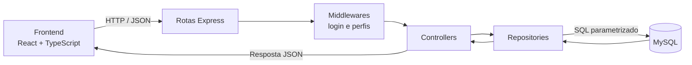
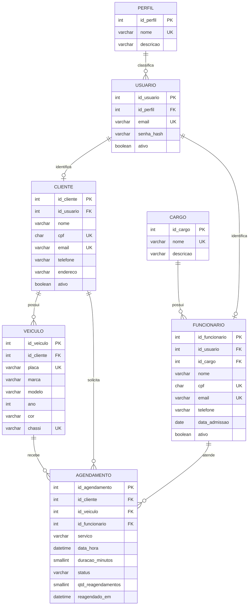

<div align="center">

# 🔧 OficinaDS

### Sistema web de gerenciamento para oficinas mecânicas

Projeto acadêmico desenvolvido para centralizar o atendimento, os clientes, os funcionários e as operações de uma oficina mecânica.


</div>

## Sobre o projeto

O **OficinaDS** é um sistema web criado para organizar informações e processos de uma oficina mecânica em um único ambiente.

O projeto completo prevê funcionalidades como autenticação, controle de permissões, clientes, veículos, funcionários, agendamentos, ordens de serviço, diagnósticos, orçamentos, estoque, financeiro e relatórios.

Histórias:

| História | Funcionalidade | Situação |
| --- | --- | :---: |
| **DM-67** | Consultar clientes | ✅ Implementada |
| **DM-100** | Pesquisar funcionários | ✅ Implementada |
| **DM-174 / DM-175** | Cliente aceita ou recusa o orçamento | ✅ Implementada |
| **DM-180** | Registrar diagnóstico | ✅ Implementada |
| — | Cadastro, login e perfis de acesso | ✅ Implementada |
| — | Atendimentos e orçamentos | ✅ Implementada |
| — | Veículos e histórico do veículo | ✅ Implementada |
| — | Reagendar serviço e consulta do cliente | ✅ Implementada |

> O sistema está em desenvolvimento. As funcionalidades marcadas como planejadas no roadmap ainda serão integradas pelo grupo.

## Funcionalidades implementadas

### DM-67 — Consultar clientes

- listagem de clientes em ordem alfabética;
- paginação dos resultados;
- exibição de CPF, e-mail, telefone e status;
- quantidade de veículos por cliente;
- consulta detalhada de um cliente;
- visualização dos veículos vinculados;
- tratamento para cliente sem veículo;
- estados de carregamento, lista vazia e erro.

### DM-100 — Pesquisar funcionários

- listagem inicial de funcionários;
- pesquisa por nome, CPF (inclusive com pontuação), e-mail ou cargo;
- filtro de funcionários ativos e inativos;
- cadastro de funcionário e alteração de cargo (Administrador);
- paginação dos resultados;
- mensagem quando não existem correspondências.

### Atendimentos e orçamentos

- lista de clientes em atendimento, com o veículo de cada um;
- inclusão e remoção de clientes da lista de atendimento;
- criação de orçamento com a situação do veículo e itens (descrição e valores);
- envio do orçamento ao cliente;
- o **Cliente** vê os próprios orçamentos em "Meus orçamentos" e **aceita ou recusa** cada um (DM-174 e DM-175);
- atendimentos realizados continuam aparecendo nos diagnósticos.

### Veículos e histórico do veículo

- listagem de veículos com o cliente e o resumo de atendimentos;
- histórico de cada veículo: atendimentos, peças utilizadas, quantidade em andamento e total gasto no período;
- busca dentro do histórico.

### DM-180 — Registrar diagnóstico

- listagem dos diagnósticos com ordem de serviço, veículo, cliente e responsável;
- registro de um novo diagnóstico, ligado ao atendimento;
- edição e exclusão de diagnósticos.

### Cadastro, login e perfis de acesso

- cadastro com escolha entre **Sou da oficina** (nasce como Funcionario) e **Sou cliente** (perfil Cliente, já com o veículo);
- login com senha criptografada e token JWT, conferindo se a conta bate com a opção escolhida;
- três perfis: **Administrador**, **Funcionario** e **Cliente**;
- menu, tela inicial e rotas adaptados ao perfil;
- bloqueio no backend (HTTP 401 sem login e 403 sem permissão);
- listagem de usuários e resumo financeiro para o Administrador.

### Agendamento e reagendamento de serviços

- listagem de agendamentos com status;
- criação de novo agendamento pela equipe;
- reagendamento de data e horário pela equipe;
- consulta dos horários disponíveis;
- validação de status permitido, antecedência mínima, expediente e conflitos de horário (profissional, veículo e capacidade da oficina);
- o **Cliente** consulta os próprios agendamentos em "Meus agendamentos" (somente leitura).

As regras e a API estão descritas em [`docs/REAGENDAMENTO.md`](docs/REAGENDAMENTO.md).

### Recursos gerais

- interface responsiva para computadores e dispositivos móveis;
- identidade visual inspirada no protótipo do Figma;
- API REST com respostas em JSON;
- consultas parametrizadas contra SQL Injection;
- validação de parâmetros da API;
- tratamento centralizado de erros;
- configurações sensíveis separadas em variáveis de ambiente;
- testes automatizados com o test runner nativo do Node.js.

## Perfis e permissões

| Área | Administrador | Funcionario | Cliente |
| --- | :---: | :---: | :---: |
| Início | ✅ | ✅ | ✅ |
| Atendimentos e orçamentos | ✅ | ✅ | ❌ |
| Veículos e histórico | ✅ | ✅ | ❌ |
| Clientes | ✅ | ✅ | ❌ |
| Diagnósticos | ✅ | ✅ | ❌ |
| Agendamentos (criar e reagendar) | ✅ | ✅ | ❌ |
| Funcionários | ✅ | ❌ | ❌ |
| Usuários | ✅ | ❌ | ❌ |
| Financeiro | ✅ | ❌ | ❌ |
| Meus orçamentos (aceitar ou recusar) | ❌ | ❌ | ✅ |
| Meus agendamentos (somente leitura) | ❌ | ❌ | ✅ |

O cliente só enxerga os próprios dados: o backend identifica o cliente pelo usuário logado, nunca por um parâmetro da requisição.

## Tecnologias

| Camada | Tecnologias |
| --- | --- |
| Frontend | React, TypeScript e Vite |
| Backend | Node.js e Express |
| Banco de dados | MySQL |
| Comunicação | API REST e JSON |
| Segurança | JWT, bcrypt, Helmet, variáveis de ambiente e consultas parametrizadas |
| Desenvolvimento | VS Code, Nodemon e MySQL Workbench |
| Versionamento | Git e GitHub |

## Arquitetura

O projeto separa apresentação, regras HTTP e acesso a dados para facilitar a integração entre os integrantes da equipe.



### Responsabilidade de cada camada

- **Frontend:** apresenta as telas e recebe as ações do usuário.
- **Routes:** relacionam os endereços da API aos controllers e definem quais perfis têm acesso.
- **Middlewares:** verificam o login, carregam o perfil, validam a permissão e tratam erros.
- **Controllers:** validam os parâmetros, aplicam as regras e montam as respostas HTTP.
- **Repositories:** concentram as consultas ao MySQL.
- **Utils:** funções de apoio e regras puras, como as de agendamento em `src/utils/regrasAgendamento.js`.
- **Banco:** armazena os dados de forma persistente.

## Estrutura do projeto

```text
OficinaDS/
├── database/
│   ├── 01_schema.sql
│   ├── 02_dados_teste.sql
│   ├── 03_usuario_aplicacao.sql
│   ├── 04_consultas_para_estudar.sql
│   ├── 05_perfis.sql
│   ├── 06_associacao_usuario_perfil.sql
│   ├── 07_perfil_cliente.sql
│   ├── 08_grant_update_perfil.sql
│   ├── 09_atendimentos_orcamentos.sql
│   ├── 10_grants_atendimentos_orcamentos.sql
│   ├── 11_grant_insert_funcionario.sql
│   ├── 12_cadastro_clientes_e_atendimento.sql
│   ├── 13_diagnosticos.sql
│   ├── 14_diagnostico_atendimento.sql
│   ├── 15_agendamentos.sql
│   ├── 16_historico_veiculo.sql
│   └── 17_atendimentos_realizados.sql
├── docs/
│   ├── DER_DO_MODULO.md
│   ├── INTEGRACAO_EQUIPE.md
│   ├── REAGENDAMENTO.md
│   └── SUBTAREFAS_E_ACEITE.md
├── frontend/
│   ├── public/
│   ├── src/
│   │   ├── components/
│   │   ├── context/
│   │   ├── pages/
│   │   ├── services/
│   │   ├── styles/
│   │   ├── types/
│   │   ├── utils/
│   │   └── App.tsx
│   ├── index.html
│   ├── package.json
│   └── vite.config.ts
├── src/
│   ├── config/
│   ├── controllers/
│   ├── middlewares/
│   ├── repositories/
│   ├── routes/
│   ├── utils/
│   ├── app.js
│   └── server.js
├── test/
├── .env.example
├── .gitignore
├── package.json
└── README.md
```

## Modelo de dados

O recorte do DER geral usado pelas funcionalidades de clientes, funcionários, perfis e agendamentos:



O DER completo e as observações sobre as relações estão em [`docs/DER_DO_MODULO.md`](docs/DER_DO_MODULO.md). As demais tabelas são criadas pelos scripts de banco:

- `atendimento`, `orcamento` e `orcamento_item`: script `09`;
- `ordem_servico` e `diagnostico`: script `13`, ligados ao atendimento pelo `14`;
- `peca_utilizada`: script `16`.

## Pré-requisitos

Antes de executar o projeto, instale:

- [Node.js](https://nodejs.org/) 20 ou mais recente;
- [MySQL Community Server](https://dev.mysql.com/downloads/mysql/) 8 ou mais recente;
- [MySQL Workbench](https://dev.mysql.com/downloads/workbench/) (opcional, se preferir não usar o terminal);
- [Git](https://git-scm.com/);
- um editor, como o [Visual Studio Code](https://code.visualstudio.com/).

## Como executar

### 1. Obtenha o projeto

Clone o repositório pelo endereço disponibilizado no botão **Code** do GitHub:

```bash
git clone URL_DO_REPOSITORIO
cd OficinaDS
```

Também é possível baixar o projeto como ZIP e abrir a pasta no VS Code.

### 2. Instale as dependências

Na raiz do projeto (backend) e na pasta `frontend`:

```bash
npm install
cd frontend
npm install
cd ..
```

### 3. Prepare o banco de dados

Execute os arquivos da pasta `database` como `root`, **nesta ordem**. A ordem importa, porque alguns scripts dependem de tabelas e do usuário criados pelos anteriores:

| # | Script | O que faz |
| :-: | --- | --- |
| 1 | `01_schema.sql` | cria o banco e as tabelas básicas |
| 2 | `02_dados_teste.sql` | adiciona dados fictícios |
| 3 | `05_perfis.sql` | cria os perfis de acesso |
| 4 | `06_associacao_usuario_perfil.sql` | liga cada usuário a um perfil |
| 5 | `07_perfil_cliente.sql` | adiciona o perfil Cliente |
| 6 | `03_usuario_aplicacao.sql` | cria o usuário usado pela aplicação (precisa vir **depois** do `06`, porque dá permissão em `usuario.id_perfil`) |
| 7 | `08_grant_update_perfil.sql` | permissão para alterar o perfil do usuário |
| 8 | `09_atendimentos_orcamentos.sql` | tabelas de atendimentos e orçamentos |
| 9 | `10_grants_atendimentos_orcamentos.sql` | permissões de atendimentos e orçamentos |
| 10 | `11_grant_insert_funcionario.sql` | permissão para cadastrar funcionários |
| 11 | `12_cadastro_clientes_e_atendimento.sql` | cadastro de clientes e ajustes em atendimentos |
| 12 | `13_diagnosticos.sql` | ordens de serviço e diagnósticos |
| 13 | `14_diagnostico_atendimento.sql` | liga o diagnóstico ao atendimento |
| 14 | `15_agendamentos.sql` | agendamentos e reagendamento |
| 15 | `16_historico_veiculo.sql` | histórico do veículo e peças utilizadas |
| 16 | `17_atendimentos_realizados.sql` | atendimentos realizados voltam a aparecer nos diagnósticos |

O arquivo `04_consultas_para_estudar.sql` é opcional e contém exemplos de consultas.

Pelo terminal, rode um por vez:

```bash
mysql -u root -p --default-character-set=utf8mb4 < database/01_schema.sql
mysql -u root -p --default-character-set=utf8mb4 < database/02_dados_teste.sql
mysql -u root -p --default-character-set=utf8mb4 < database/05_perfis.sql
mysql -u root -p --default-character-set=utf8mb4 < database/06_associacao_usuario_perfil.sql
mysql -u root -p --default-character-set=utf8mb4 < database/07_perfil_cliente.sql
mysql -u root -p --default-character-set=utf8mb4 < database/03_usuario_aplicacao.sql
mysql -u root -p --default-character-set=utf8mb4 < database/08_grant_update_perfil.sql
mysql -u root -p --default-character-set=utf8mb4 < database/09_atendimentos_orcamentos.sql
mysql -u root -p --default-character-set=utf8mb4 < database/10_grants_atendimentos_orcamentos.sql
mysql -u root -p --default-character-set=utf8mb4 < database/11_grant_insert_funcionario.sql
mysql -u root -p --default-character-set=utf8mb4 < database/12_cadastro_clientes_e_atendimento.sql
mysql -u root -p --default-character-set=utf8mb4 < database/13_diagnosticos.sql
mysql -u root -p --default-character-set=utf8mb4 < database/14_diagnostico_atendimento.sql
mysql -u root -p --default-character-set=utf8mb4 < database/15_agendamentos.sql
mysql -u root -p --default-character-set=utf8mb4 < database/16_historico_veiculo.sql
mysql -u root -p --default-character-set=utf8mb4 < database/17_atendimentos_realizados.sql
```

> No Windows, o `--default-character-set=utf8mb4` evita erros de codificação e acentos quebrados. Pare no primeiro erro e corrija antes de continuar. Se precisar recomeçar do zero, apague o banco com `DROP DATABASE oficina_ds;` e refaça a sequência. Repetir o `15_agendamentos.sql` recalcula as datas dos agendamentos de exemplo e apaga os reagendamentos que você tiver testado.

Confira se os perfis foram criados:

```bash
mysql -u root -p oficina_ds -e "SELECT * FROM perfil;"
```

### 4. Configure as variáveis de ambiente

Crie o arquivo `.env` a partir do modelo.

No Prompt de Comando do Windows:

```cmd
copy .env.example .env
```

No PowerShell:

```powershell
Copy-Item .env.example .env
```

No Linux, macOS ou Git Bash:

```bash
cp .env.example .env
```

Estrutura esperada:

```dotenv
PORT=3000
JWT_SECRET=troque-por-um-texto-secreto
DB_HOST=localhost
DB_PORT=3306
DB_USER=oficina_app
DB_PASSWORD=TroqueEstaSenha123!
DB_NAME=oficina_ds
DB_CONNECTION_LIMIT=10
```

O valor de `DB_PASSWORD` deve ser igual ao definido em `database/03_usuario_aplicacao.sql`.

> Nunca envie o arquivo `.env` ao GitHub. Somente o `.env.example` deve ser versionado.

### 5. Inicie o sistema

São dois terminais abertos ao mesmo tempo.

**Terminal 1 — backend (porta 3000):**

```bash
npm run dev
```

Deve aparecer `✓ Conexão com o MySQL estabelecida.`. Para testar:

```bash
curl http://localhost:3000/api/saude
```

**Terminal 2 — frontend (porta 5173):**

```bash
cd frontend
npm run dev
```

Depois, acesse [http://localhost:5173](http://localhost:5173). O Vite encaminha as chamadas `/api` para o backend.

Modo normal (um terminal só): gere o frontend e o Express passa a servi-lo na porta 3000.

```bash
cd frontend
npm run build
cd ..
npm start
```

Acesse [http://localhost:3000](http://localhost:3000).

### Criar usuários de teste

Os usuários de exemplo do script `06` têm senha fictícia e não servem para login. Cadastre usuários reais pela tela de cadastro (`/cadastro`), escolhendo **Sou da oficina** ou **Sou cliente**, ou pela API:

```bash
curl -X POST http://localhost:3000/api/cadastro -H "Content-Type: application/json" -d '{"tipoAcesso":"oficina","nome":"Admin Teste","cpf":"52998224725","email":"admin@oficina.test","senha":"123456"}'
```

O nome, o CPF (11 dígitos, único por pessoa), o e-mail e a senha são obrigatórios. Quem se cadastra como **oficina** nasce como **Funcionario**. Para promover a Administrador:

```bash
mysql -u root -p oficina_ds -e "UPDATE usuario SET id_perfil = 1 WHERE email = 'admin@oficina.test';"
```

Depois faça login de novo para o novo perfil valer.

Para testar o **Cliente**, cadastre-o pela tela com **Sou cliente**. Esse cadastro cria o cliente e o veículo dele. Na tela de login, use a opção correspondente ao tipo de conta (**Sou da oficina** ou **Sou cliente**).

## API

Todas as rotas, exceto `saude`, `cadastro` e `login`, exigem o cabeçalho `Authorization: Bearer <token>`. "Equipe" significa Administrador e Funcionario.

| Método | Endpoint | Perfis | Descrição |
| --- | --- | --- | --- |
| `GET` | `/api/saude` | público | Verifica se o servidor está funcionando |
| `POST` | `/api/cadastro` | público | Cria uma conta (oficina ou cliente) |
| `POST` | `/api/login` | público | Autentica e devolve o token |
| `GET` | `/api/me` | logado | Dados do usuário logado e seu perfil |
| `GET` | `/api/clientes` | Equipe | Lista os clientes com paginação |
| `GET` | `/api/clientes/opcoes` | Equipe | Clientes e veículos para os formulários |
| `GET` | `/api/clientes/:id` | Equipe | Consulta um cliente e seus veículos |
| `GET` | `/api/funcionarios` | Admin | Pesquisa e filtra funcionários |
| `POST` | `/api/funcionarios` | Admin | Cadastra um funcionário |
| `PATCH` | `/api/funcionarios/:id/cargo` | Admin | Altera o cargo de um funcionário |
| `GET` | `/api/cargos` | Admin | Lista os cargos |
| `POST` | `/api/cargos` | Admin | Cria um cargo |
| `GET` | `/api/usuarios` | Admin | Lista os usuários |
| `GET` | `/api/financeiro/resumo` | Admin | Resumo financeiro |
| `GET` | `/api/atendimentos` | Equipe | Lista os atendimentos em andamento |
| `POST` | `/api/atendimentos` | Equipe | Inclui um cliente na lista de atendimento |
| `DELETE` | `/api/atendimentos/:id` | Equipe | Remove um atendimento da lista |
| `POST` | `/api/atendimentos/:id/orcamento` | Equipe | Cria o orçamento do atendimento |
| `GET` | `/api/orcamentos` | Equipe | Lista os orçamentos |
| `PATCH` | `/api/orcamentos/:id/status` | Equipe | Envia o orçamento ao cliente |
| `GET` | `/api/orcamentos/meus` | Cliente | Orçamentos do próprio cliente |
| `GET` | `/api/orcamentos/:id` | Equipe e Cliente | Detalhes de um orçamento |
| `PATCH` | `/api/orcamentos/:id/decisao` | Cliente | Aceita ou recusa um orçamento |
| `GET` | `/api/veiculos` | Equipe | Lista os veículos |
| `GET` | `/api/veiculos/:id` | Equipe | Consulta um veículo |
| `GET` | `/api/veiculos/:id/historico` | Equipe | Histórico de atendimentos e peças do veículo |
| `GET` | `/api/diagnosticos` | Equipe | Lista os diagnósticos |
| `GET` | `/api/diagnosticos/opcoes` | Equipe | Ordens e funcionários para o formulário |
| `POST` | `/api/diagnosticos` | Equipe | Registra um diagnóstico |
| `PATCH` | `/api/diagnosticos/:id` | Equipe | Edita um diagnóstico |
| `DELETE` | `/api/diagnosticos/:id` | Equipe | Exclui um diagnóstico |
| `GET` | `/api/agendamentos` | Equipe | Lista agendamentos |
| `GET` | `/api/agendamentos/meus` | Cliente | Agendamentos do próprio cliente (somente leitura) |
| `GET` | `/api/agendamentos/opcoes` | Equipe | Veículos, profissionais e regras |
| `GET` | `/api/agendamentos/horarios` | Equipe | Horários livres para novo agendamento |
| `GET` | `/api/agendamentos/:id/horarios` | Equipe | Horários livres para reagendar |
| `POST` | `/api/agendamentos` | Equipe | Cria um agendamento |
| `PATCH` | `/api/agendamentos/:id/reagendar` | Equipe | Reagenda um serviço |

O Administrador tem acesso a todas as rotas, inclusive às de Funcionario.

### Parâmetros da listagem de clientes

```http
GET /api/clientes?pagina=1&limite=8
```

### Parâmetros da pesquisa de funcionários

```http
GET /api/funcionarios?busca=mecanico&status=ativos&pagina=1&limite=8
```

| Parâmetro | Valores | Padrão |
| --- | --- | --- |
| `busca` | nome, CPF, e-mail ou cargo | vazio |
| `status` | `todos`, `ativos` ou `inativos` | `todos` |
| `pagina` | inteiro positivo | `1` |
| `limite` | inteiro entre 1 e 50 | `8` |

### Reagendar um serviço

```http
PATCH /api/agendamentos/1/reagendar
Content-Type: application/json

{ "data": "2026-10-22", "hora": "14:00" }
```

Erros de regra: `422` (status não permitido, antecedência insuficiente, fora do expediente) e `409` (conflito de horário). Detalhes em [`docs/REAGENDAMENTO.md`](docs/REAGENDAMENTO.md).

## Testes

Execute os testes automatizados do backend:

```bash
npm test
```

Verifique os tipos do frontend:

```bash
cd frontend
npx tsc -b
```

O projeto possui testes para:

- servidor HTTP, rota de saúde e rotas inexistentes;
- paginação, validação de identificadores e de dados de cadastro;
- clientes e filtros de funcionários;
- perfis e permissões (login, 401 e 403);
- atendimentos, ordens de serviço e status de orçamento;
- diagnósticos (validação e acesso ao banco);
- histórico do veículo;
- regras de agendamento e reagendamento (status, antecedência, expediente e conflitos) e a consulta do cliente.

## Integração da equipe

Para evitar conflitos entre as histórias:

- utilize uma branch por funcionalidade;
- não envie `node_modules` ou `.env` ao repositório;
- mantenha os nomes das tabelas e colunas definidos no DER central;
- preserve o formato combinado das respostas JSON;
- use a conexão MySQL compartilhada do projeto;
- ao criar um script de banco novo, use o próximo número da sequência e inclua-o na tabela de execução deste README;
- execute os testes antes de abrir um pull request;
- confirme que as funcionalidades anteriores continuam funcionando após o merge.

Mais detalhes estão em [`docs/INTEGRACAO_EQUIPE.md`](docs/INTEGRACAO_EQUIPE.md).

## Roadmap

- [x] Consultar clientes e ver os veículos de cada um;
- [x] pesquisar e filtrar funcionários;
- [x] cadastro de funcionários e alteração de cargo;
- [x] cadastro e login de usuários, com cadastro de cliente e veículo;
- [x] controle de perfis e permissões;
- [x] atendimentos e orçamentos, com aceite ou recusa do cliente;
- [x] veículos e histórico do veículo;
- [x] registrar diagnósticos;
- [x] agendar e reagendar serviços;
- [x] cliente consulta os próprios orçamentos e agendamentos;
- [ ] cliente solicitar ou reagendar o próprio agendamento pelo portal;
- [ ] cancelamento de agendamentos e controle de urgência;
- [ ] cadastro e edição de veículos pelas telas da oficina;
- [ ] histórico de status das ordens de serviço;
- [ ] controle e solicitação de peças;
- [ ] controle financeiro completo;
- [ ] avaliações, presença e relatórios.

## Boas práticas adotadas

- senhas são guardadas criptografadas e as configurações locais não ficam no repositório;
- consultas utilizam parâmetros em vez de concatenar entradas do usuário;
- o usuário MySQL da aplicação recebe somente as permissões mínimas de que cada módulo precisa;
- as permissões são conferidas no backend, e não apenas escondidas no menu;
- o cliente é identificado pelo usuário logado, e não por parâmetros da requisição;
- o reagendamento usa transação, para duas pessoas não ocuparem o mesmo horário;
- dados de demonstração são fictícios e utilizam o domínio reservado `.test`;
- erros internos não são expostos diretamente ao navegador;
- frontend e backend seguem contratos documentados.

## Equipe

Desenvolvido em equipe como projeto acadêmico de Engenharia de Software e Desenvolvimento Web.

## Situação do projeto

O OficinaDS está em construção e será ampliado ao longo das próximas sprints. Sugestões, correções e novas funcionalidades devem ser discutidas pela equipe antes da integração ao branch principal.
